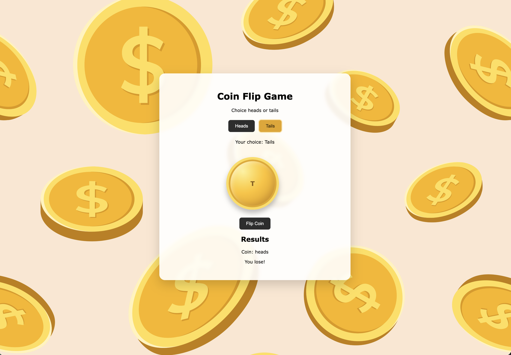

### 📄 Description

# Project: Node Coin Flip Game

### A simple coin flip guessing web application that uses the fs and http modules. Used http to create the server and fs to read your html file.

### ✨ Key Features

- **Feature A:** Server-Side Coin randomization: Heads or tails is determined on the Node.js server rather than in the browser, giving the project a true frontend to backend request flow.
- **Feature B:** Interactive 3D Coin Flip: Players choose heads or tails and watch a gold coin animate before landing on the server generated result and displaying whether they won or lost.
- **Feature C:** Fast & responsive Gameplay: Uses the native Node.js http and fs modules with lightweight vanilla javascript and responsive styling for a quick, framework-free experience.

### 🛠️ Tech Used

- HTML
- CSS
- JS
- [Node JS]

